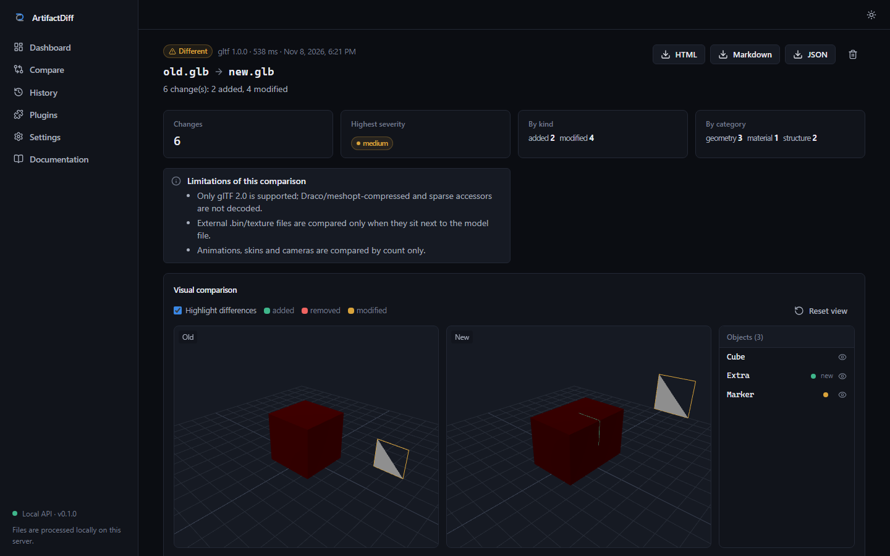
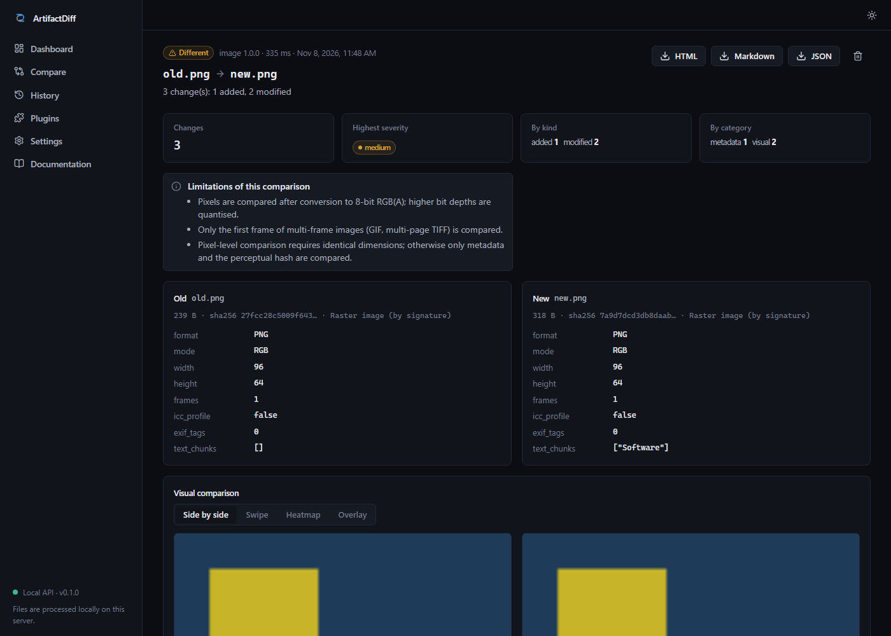
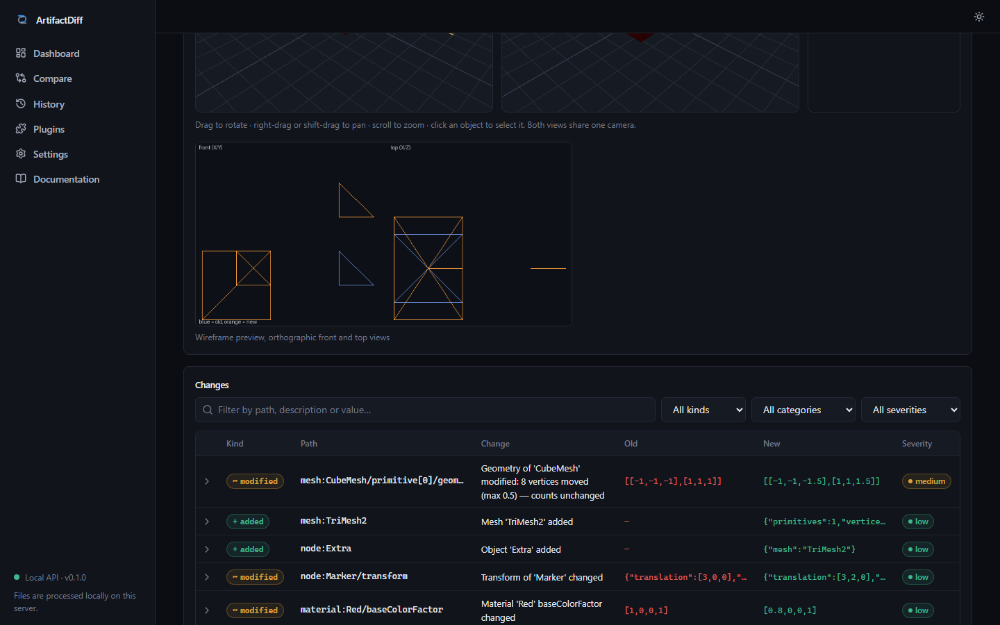
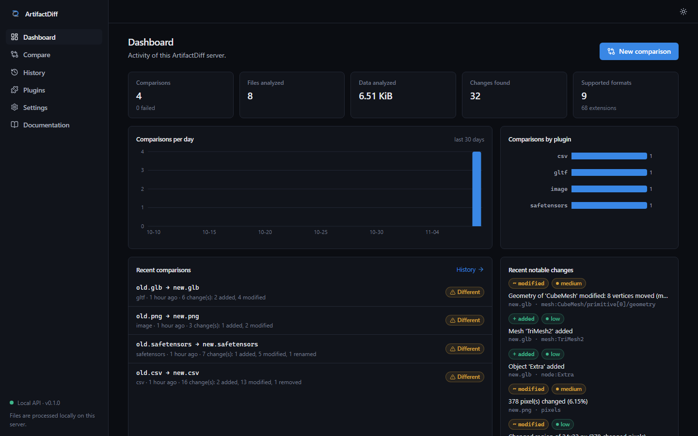

# ArtifactDiff

**The universal diff for everything Git cannot meaningfully compare.**

ArtifactDiff compares versions of datasets, databases, ML weights, images, audio, PDFs and 3D
models and tells you *what* changed — structurally, with evidence — on the command line, in a local
web UI, and as a pull-request comment.

```console
$ artifactdiff diff examples/sqlite/old.sqlite examples/sqlite/new.sqlite
 DIFFERENT  10 change(s): 4 added, 2 modified, 4 removed
 old.sqlite → new.sqlite   plugin sqlite 1.0.0 · 56 ms
 sev    │ kind     │ path                      │ change                               │ old → new
 high   │ removed  │ table:legacy              │ Table 'legacy' removed               │ CREATE TABLE legacy (x INTEGER) → —
 low    │ added    │ table:users/column:active │ Column 'active' added to 'users'     │ — → INTEGER
 medium │ modified │ index:idx_users_email     │ Index 'idx_users_email' changed      │ CREATE INDEX … → CREATE UNIQUE INDEX …
 medium │ removed  │ trigger:trg               │ Trigger 'trg' removed                │ CREATE TRIGGER trg AFTER INSERT … → —
 low    │ modified │ table:users/row[id=2]     │ 1 cell(s) changed in 'users'         │ {"name": "Bob"} → {"name": "Robert"}
 low    │ removed  │ table:users/row[id=3]     │ Row removed from 'users'             │ {"id": 3, "email": "c@x.io", … → —
 …
 ⚠ no-primary-key: Table 'logs' has no usable primary key: a modified row is reported as one removed and one added row
```

(Real output, abridged; run it yourself against the bundled [examples](examples/).)

## Why

Git diffs text. But repositories also carry model weights, Parquet datasets, SQLite fixtures,
textures, audio, PDFs and glTF scenes. For those, a pull request shows *"Binary file changed"*, and
reviewers either download both versions and open specialist tools, or approve blind.

ArtifactDiff makes those changes reviewable:

- **Structural, not byte-level.** Added tensors and changed shapes, renamed tables, inserted PDF
  pages, moved 3D objects, rows changed by primary key.
- **Evidence for every change.** Each reported change says how it was detected. Nothing is inferred
  silently; heuristics (renames) carry a confidence and an explanation.
- **Honest about limits.** Every result lists the limitations of the comparison that produced it.
  Measures such as SSIM are reported as measurements, never as probabilities.
- **Local-first and private.** Files are analysed on your machine or CI runner. No accounts, no
  telemetry, no uploads.
- **Extensible.** A small, typed plugin SDK; third-party plugins load only when you enable them.

## Supported formats

| Plugin | Formats | What is compared |
|---|---|---|
| `json` | `.json`, `.geojson`, `.ipynb`, … | Structure, values, types; JSONPath + JSON Pointer paths; LCS / index / key array matching |
| `csv` | `.csv`, `.tsv` | Columns, inferred types, rows by primary key (or content multiset), duplicates, missing values, statistics |
| `parquet` | `.parquet` | Arrow schema, nullability, footer metadata, rows, statistics |
| `sqlite` | `.sqlite`, `.db` | Tables, columns, indexes, triggers, views, rows (streaming merge-join on primary keys); read-only |
| `image` | PNG, JPEG, WebP, TIFF, BMP, GIF | Dimensions, ICC profile, EXIF/text metadata, pixels, SSIM, perceptual hash, changed regions, heatmap/overlay |
| `audio` | WAV, FLAC, OGG, MP3¹ | Format, duration, sample rate, channels, RMS/peak level, silence, spectral bands, waveform differences |
| `pdf` | PDF | Page alignment, text, page size, image objects, metadata, rendered visual differences |
| `gltf` | `.glb`, `.gltf` | Scene graph, transforms, mesh geometry (hash + vertex displacement), materials, textures, bounds |
| `safetensors` | `.safetensors` | Tensors, dtypes, shapes, metadata, chunked statistics, L2 / max-abs / relative differences, renames |
| `text` | YAML, TOML, Markdown, … | Line diff (fallback for text) |
| `binary` | anything | Size, hashes, exact differing byte ranges (fallback) |

¹ MP3 depends on your libsndfile build; `artifactdiff doctor` tells you. Details and per-format
limitations: [docs/supported-formats.md](docs/supported-formats.md), [docs/limitations.md](docs/limitations.md).

## Installation

```bash
pipx install "artifactdiff[all]"        # CLI + every format + web UI
pip install artifactdiff                 # core only: JSON, SQLite, text, binary
pip install "artifactdiff[tabular,safetensors]"   # pick extras: tabular image audio pdf gltf safetensors api
artifactdiff doctor                      # check what is available
```

Requires Python 3.12+. See [docs/installation.md](docs/installation.md) (including Docker).

## Command line

```bash
artifactdiff diff old.parquet new.parquet
artifactdiff diff old.glb new.glb --format html --output report.html
artifactdiff diff users-v1.csv users-v2.csv -O primary_key=id --fail-on medium
artifactdiff diff data/ data-v2/ --recursive --exclude "*.log" --format markdown
artifactdiff inspect model.safetensors
artifactdiff plugins list
artifactdiff report result.json --format html -o report.html
```

Exit codes are CI-friendly: `0` no differences · `1` differences · `2` usage/input error ·
`3` comparison failed. Full reference: [docs/cli.md](docs/cli.md).

## GitHub Action

```yaml
name: ArtifactDiff
on:
  pull_request:
    types: [opened, synchronize, reopened]
permissions:
  contents: read
  pull-requests: write
jobs:
  compare:
    runs-on: ubuntu-latest
    steps:
      - uses: actions/checkout@v7
        with:
          fetch-depth: 0
      - uses: Pokeuuu/artifactdiff@v1
        with:
          base: ${{ github.event.pull_request.base.sha }}
          head: ${{ github.event.pull_request.head.sha }}
          report-format: markdown
          comment-on-pr: true
```

The action compares only changed, supported artifacts (handling added, deleted and renamed files),
posts or updates **one** PR comment, and uploads HTML/JSON reports as a workflow artifact. It reads
changed files from git objects as data and never executes pull-request code. See
[docs/github-action.md](docs/github-action.md) for inputs, outputs, permissions and fork behaviour.

## Web UI

```bash
artifactdiff serve          # http://127.0.0.1:8000 (local only by default)
```

Dashboard, drag-and-drop comparisons with plugin options generated from each plugin's schema,
history with search/filter/export, and format-specific viewers: Monaco diff for JSON/text,
side-by-side / swipe / heatmap / overlay for images, waveform and spectrogram with playback for
audio, page overlays for PDFs, schema/data/statistics tabs for tables, per-tensor charts for
weights, and a synchronized two-pane Three.js viewer for glTF.

| Synchronized 3D viewer (glTF) | Changed region overlay (image) |
|---|---|
|  |  |
| **Change table with evidence** | **Dashboard** |
|  |  |

<sub>Screenshots of the bundled [examples](examples/) running in the local web UI.</sub>

## Architecture

```
packages/core     artifactdiff          models, plugin contract, registry, engine, isolation, reports
packages/plugins  artifactdiff_plugins  built-in format plugins (heavy deps imported lazily)
packages/sdk      artifactdiff_sdk      stable plugin-author API, testing helpers, project scaffold
cli               artifactdiff_cli      Typer CLI
apps/api          artifactdiff_api      FastAPI + SQLAlchemy + Alembic, background jobs
apps/web          React + TypeScript + Vite + Tailwind web UI
integrations/github-action              action runner (action.yml lives at the repo root)
```

Plugins report changes into a `ComparisonContext`; the engine assembles results with stable IDs,
statistics, a reproducibility block and a deterministic fingerprint. More in
[docs/architecture.md](docs/architecture.md).

## Writing a plugin

```bash
artifactdiff plugins new my-format -e .myf
```

generates a working plugin project with tests. See [docs/plugin-development.md](docs/plugin-development.md)
and the complete example in [examples/plugins/artifactdiff-plugin-ini](examples/plugins/artifactdiff-plugin-ini).

## Contributing

Contributions are welcome — especially new format plugins. Start with [CONTRIBUTING.md](CONTRIBUTING.md);
`make setup && make test` gets you going. Please read the [Code of Conduct](CODE_OF_CONDUCT.md) and
report vulnerabilities privately as described in [SECURITY.md](SECURITY.md).

## Roadmap

ONNX and GGUF weights (the tensor comparison core is format-neutral already), Draco-compressed glTF,
LUFS loudness, OCR for scanned PDFs (opt-in), Excel/Office documents, and VS Code integration. See
[docs/roadmap.md](docs/roadmap.md).

## License

[Apache-2.0](LICENSE).
